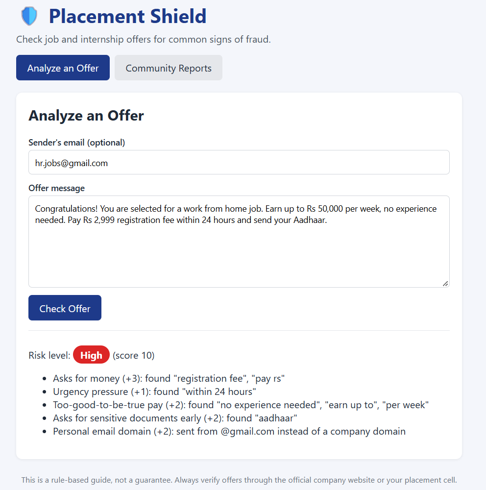

# Placement Shield 🛡️

**Job & Internship Offer Risk Analyzer** – a web app that helps students check job and internship offers for common signs of fraud.

> **Status:** 🚧 Work in progress. The React frontend is working. The backend (Node.js, Express, MongoDB) for community reports is being built; see [ROADMAP.md](ROADMAP.md).



## The Problem

Students often receive fake job or internship offers that ask for "registration fees", come from personal email addresses, or promise unrealistic pay. Many students can't tell what's genuine, especially for their first offer.

## What It Does

- [x] **Analyze an offer** – paste the offer message and the sender's email; the app checks it for red flags
- [x] **Risk level** – shows **Low**, **Medium** or **High** risk, with the reasons
- [ ] **Report an offer** – submit a suspicious company to a community database *(backend in progress)*
- [ ] **Search reports** – look up a company to see if others have reported it *(backend in progress)*

## Red Flags Checked

| Red flag | Example keywords | Points |
|---|---|---|
| Asks for money | "registration fee", "security deposit", "processing fee", "pay rs" | +3 |
| Personal email domain | `@gmail.com`, `@yahoo.com` instead of a company domain | +2 |
| Urgency pressure | "urgent", "within 24 hours", "limited seats" | +1 |
| Too-good-to-be-true pay | "earn up to", "per week", "no experience needed" | +2 |
| Asks for sensitive documents early | "Aadhaar", "PAN card", "bank details", "OTP" | +2 |
| Reported by other students *(planned)* | company name found in community reports | +3 |

**Score → risk level:** 0–2 = Low, 3–5 = Medium, 6+ = High

This is a simple rule-based checker meant as a guide, not a guarantee. Students should always verify offers through official company websites or their placement cell.

## Tech Stack

- **Frontend (done):** React (Vite), plain CSS
- **Backend (in progress):** Node.js + Express REST API
- **Database (planned):** MongoDB (MongoDB Atlas) with Mongoose

## Project Structure

```
placement-shield/
├── client/                     # React frontend
│   ├── index.html
│   └── src/
│       ├── main.jsx            # Starts React
│       ├── App.jsx             # Header + switching between the two pages
│       ├── App.css
│       ├── utils/
│       │   └── riskChecker.js  # The rule-based scoring logic
│       └── pages/
│           ├── Analyze.jsx     # Offer form + risk result
│           └── Reports.jsx     # Community reports (coming soon)
├── package.json                # Lets you run `npm run dev` from the main folder
├── screenshot.png
├── README.md
└── ROADMAP.md
```

## How to Run Locally

**Requirements:** Node.js 18+

First time only, install the dependencies:

```
cd client
npm install
cd ..
```

Then start the app from the main folder:

```
npm run dev
```

The app opens in your browser at `http://localhost:5173`.

## Next Steps

- Move the risk checker to an Express API (`POST /api/analyze`)
- Store community reports in MongoDB (`POST /api/reports`, `GET /api/reports?company=name`)
- Add the "+3 if reported by other students" rule
- Later: login, upvoting reports, and an NLP/ML model instead of only fixed rules

## Author

**Devesh Sureka** – B.Tech CSE, Amity University Kolkata
